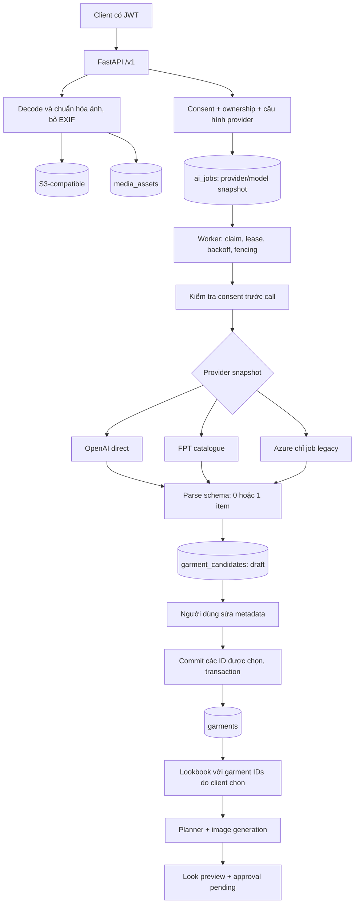

# 01 — Điều tra VLM AS-IS trước thay đổi

## Tóm tắt điều hành và mốc bằng chứng

- **Mốc AS-IS:** commit `52346ec95f53bb29b28a8f48c62efbf8097ce2ab`, khảo sát ngày 30/10/2026, trước thay đổi A/B của lượt triển khai hiện tại. Các tham chiếu `file:line` trong bộ tài liệu là đường dẫn tương đối từ `garblo-backend/` tại mốc này; số dòng ở working tree sau triển khai có thể khác. Có thể đối chiếu bằng `git show 52346ec95f53bb29b28a8f48c62efbf8097ce2ab:<path>`.
- Backend đã có FastAPI, SQLAlchemy, Alembic, PostgreSQL queue, worker riêng và storage S3-compatible; **không phải dự án chưa có backend**.
- Catalogue đã có upload thật về mặt implementation, provider adapter, draft, sửa metadata và commit có khóa; contract VLM chỉ cho **tối đa một món/ảnh**. Không có segmentation pixel-level, screening riêng hay escalation trong luồng đã khảo sát.
- Lookbook hiện hữu là pipeline tạo ảnh từ danh sách garment người dùng chọn; **không tương đương** recommendation lọc/rank Top 3, chỉnh slot hay personalization.
- Đây là **điều tra source và thiết kế**, không phải báo cáo nghiệm thu. Không chạy provider tính phí, migration hay kiểm thử runtime trong phần tài liệu này. `IMPLEMENTED` chỉ nghĩa là có implementation được đọc; không xác nhận môi trường đang vận hành đúng.

### Nguồn yêu cầu

1. `docs/hand-off-image_to_wardobe.md:15-43`: điều tra trước, tái sử dụng backend; trọng tâm Image-to-Component → Wardrobe, không triển khai VTON.
2. `docs/hand-off-image_to_wardobe.md:105-120`: routing trong tài liệu nguồn là mục tiêu; mọi định danh model phải được xác minh trước khi cấu hình.
3. `docs/hand-off-image_to_wardobe.md:195-224`: phân loại trạng thái, bằng chứng source, các câu hỏi gap.
4. `docs/prompt_improve-agent.md:14-29`: tủ đồ thật, context, Top 3, typed/validated IDs, deterministic filtering/ranking, ownership và giới hạn LLM.
5. Phạm vi phối hợp hiện tại: **A trước; B chỉ bắt đầu sau nghiệm thu A**. Tài liệu này giữ nguyên lịch sử AS-IS; main agent sẽ bổ sung báo cáo nghiệm thu riêng sau kiểm thử thực tế.

### Quy ước trạng thái

| Nhãn | Ý nghĩa trong báo cáo |
|---|---|
| `IMPLEMENTED` | Đã thấy nhánh code thực hiện, chưa xác nhận thực thi |
| `PARTIAL` | Có một phần yêu cầu nhưng thiếu invariant/contract liên quan |
| `MOCKED` | Đường kiểm thử dùng dữ liệu/provider/storage thay thế |
| `NOT_FOUND` | Không tìm thấy implementation trong phạm vi source khảo sát |
| `NOT_VERIFIED` | Chưa có bằng chứng kiểm thử/runtime/quyền truy cập provider |
| `DESIGN` | Đề xuất TO-BE, không suy ra đã được triển khai |

## Stack và điểm vào

| Thành phần | Bằng chứng AS-IS | Nhận xét |
|---|---|---|
| Python ≥3.12; FastAPI/Pydantic/SQLAlchemy/Alembic | `pyproject.toml:10-27` | Tái sử dụng stack, không thêm orchestrator framework cho MVP |
| App, CORS, router `/v1` mặc định | `src/garblo/main.py:11-20`, `src/garblo/config.py:13` | Các route dưới đây có prefix `/v1` |
| CLI API và worker riêng | `pyproject.toml:37-39`, `src/garblo/worker.py:423-439` | Không chạy worker bên trong request HTTP |
| PostgreSQL queue | `src/garblo/models.py:148-165`, `src/garblo/worker.py:115-142` | `FOR UPDATE SKIP LOCKED`, không Redis/Celery |
| Compose API/worker, migrate, storage-init | `compose.yaml:46-77` | Mô tả cấu hình, chưa xác nhận các container đang chạy |
| S3-compatible/RustFS | `src/garblo/storage.py:22-49`, `compose.yaml:33-43` | Private download qua signed URL |
| Mock UI | `src/garblo/main.py:33-39`, `src/garblo/config.py:19` | Có UI test thủ công không đồng nghĩa provider giả ở production; Compose tắt rõ tại `compose.yaml:8-9` |

## Kiến trúc AS-IS

Không có node screening độc lập hoặc segmentation trong sơ đồ AS-IS. Nhánh Azure ở mô tả workflow của nguồn bàn giao (`docs/hand-off-image_to_wardobe.md:165-182`) không còn là tuyến mặc định của request mới: `CatalogueRequest` chỉ cho `openai`/`fpt` (`src/garblo/schemas.py:85-86`); registry giữ Azure cho legacy (`src/garblo/ai_providers/registry.py:8-29`).

## Truy vết Upload → Wardrobe

| Bước | Entry point / contract | Đọc/ghi, dependency | Lỗi và trạng thái |
|---|---|---|---|
| Upload | `POST /assets`, multipart `file`, `asset_type`; `AssetResponse` | `src/garblo/api/routes.py:180-219`; chuẩn hóa rồi SHA-256 bytes sạch, ghi object trước row `MediaAsset` | Rỗng 422; quá byte 413; decode/format/pixel 415; storage 503. `IMPLEMENTED`; object orphan nếu DB lỗi chưa có cleanup luồng này |
| Chuẩn hóa ảnh | JPEG/PNG/WebP thật, một frame, giới hạn pixel, orientation rồi re-encode | `src/garblo/images.py:9-43` | Không chỉ tin MIME/extension client; đây là kiểm tra kỹ thuật, không screening nội dung |
| Download | `GET /assets/{id}/download`; URL có TTL | `src/garblo/api/routes.py:233-242`, `src/garblo/storage.py:74-79` | Ownership 404 trước presign; TTL mặc định tại `src/garblo/config.py:28` |
| Tạo job | `POST /assets/{id}/catalogize`, body có thể vắng, provider mặc định OpenAI; trả job ID | `src/garblo/api/routes.py:245-286`; consent, lock asset, provider/model snapshot, đổi asset `analyzing`, tạo `AiJob` | Thiếu consent 409; thiếu config 503; không đúng loại 422; đã phân tích 409. Không tự enqueue provider khác |
| Claim/recovery | Worker quét queued đến lịch | `src/garblo/worker.py:88-142`; tăng `attempts`, token mới, lease | Reclaim lease hết hạn có tổng attempt budget; `SKIP LOCKED`; không chứng minh cạnh tranh PostgreSQL bằng test SQLite |
| Gọi analysis | Resolve theo snapshot, đọc object, chuẩn hóa lại | `src/garblo/worker.py:180-186`, `246-264`; adapter OpenAI/FPT/legacy | Check lease + consent trước callback (`154-162`); HTTP timeout/429/5xx được adapter phân loại; không ghi raw traceback |
| Validate + repair | Strict Pydantic, `items` tối đa 1; có một lượt sửa JSON | `src/garblo/ai_providers/contracts.py:15-43`, `69-76`; OpenAI `78-97`, FPT `143-168` | Không có confidence/uncertainty có cấu trúc. Repair là physical request thứ hai, không phải attempt worker mới |
| Lưu draft | Sau call kiểm tra lại lease/consent; mỗi item → candidate | `src/garblo/worker.py:191-207`, `266-296`; lưu attributes gốc và bản sửa | Không tạo garment ở analysis; asset `analyzed`/`no_items`; job output gồm candidate IDs và usage lượt thành công cuối |
| Review | `GET /assets/{id}/candidates`; `PATCH /candidates/{id}` | `src/garblo/api/routes.py:289-318`, `src/garblo/schemas.py:89-106` | Chỉ draft được sửa; committed 409. Chưa có reject/restore |
| Commit | `POST /assets/{id}/commit`, chọn candidate IDs | `src/garblo/api/routes.py:321-357`; lock asset/candidate, tạo Garment và đánh dấu committed cùng transaction | ID ngoài asset/owner 404; trạng thái không hợp lệ 409; gửi lại committed dùng garment ID cũ. Asset luôn `catalogued` dù còn draft: cần sửa cho multi-item |
| Đọc/sửa tủ | `GET /garments`, `GET/PATCH /garments/{id}` | `src/garblo/api/routes.py:360-398`; lọc owner, category/tags | Không có filter `catalog_status=active` trong list; B phải tự áp dụng active filter trên query recommendation |

## Hợp đồng, dữ liệu, retry và audit

- `GarmentAttributes` có năm trường: category/color/material/season nullable nhưng bắt buộc xuất hiện; tags là danh sách có giới hạn, `extra=forbid`, strict. `AnalysisResult.items` tối đa 1 (`src/garblo/ai_providers/contracts.py:15-28`). Một object legacy được bọc thành một item tại `69-74`. Không có version schema trên payload.
- OpenAI gọi chat với `temperature=0`, giới hạn output, SDK `max_retries=0`; hiện yêu cầu JSON bằng prompt rồi local validation, **không thấy khai báo native JSON Schema response format** (`src/garblo/ai_providers/openai_direct.py:33-54`, `62-97`). `temperature=0` không bảo đảm model tái lập bit-for-bit.
- FPT nhận JSON hoặc SSE, giới hạn body/deadline, chuẩn hóa response (`src/garblo/ai_providers/fpt_qwen.py:22-82`, `91-125`). Tên model mặc định trong config **không chứng minh quyền truy cập/capability thực tế**; bộ thiết kế không chốt ID đó.
- Snapshot hiện chỉ có provider/model/request time, thêm image model cho lookbook (`src/garblo/jobs.py:30-39`); thiếu prompt/schema/pipeline/policy version. Job legacy thiếu model bị từ chối, không tự dùng model hiện tại (`src/garblo/jobs.py:7-26`).
- Lỗi retryable dùng backoff lũy thừa + jitter và tổng số claim bounded (`src/garblo/worker.py:214-237`). Retry thủ công giữ attempts/snapshot (`src/garblo/api/routes.py:526-567`). **Số claim không bằng số physical request:** mỗi analysis adapter có thể gọi 2 lần để repair; usage được trả về chỉ ở lần cuối thành công. Không có ledger từng call/failed call hoặc ngân sách tiền/token tổng job.
- `GarmentCandidate` có unique `(job_id, candidate_index)`, original/current attributes và unique garment link (`src/garblo/models.py:168-186`). `Look.source_job_id` unique (`116-132`). Đây là guard DB hữu ích nhưng không tự bảo đảm exactly-once external inference.
- Migration hiện hữu bổ sung candidates/lease/source job tại `migrations/versions/20261030_0002_providers_candidates_recovery.py:16-56`, sau migration ban đầu. Không sửa migration đã phát hành; thay schema cần revision mới.

## Security và giới hạn đã quan sát

| Chủ đề | Bằng chứng và giới hạn |
|---|---|
| Consent | Route kiểm tra tại `src/garblo/api/routes.py:96-101`; worker kiểm tra trước call và trước lưu tại `src/garblo/worker.py:154-162`, `191-197`. Latest consent được query lại tại `src/garblo/consent.py:7-15`. Không thể thu hồi request đã gửi ra ngoài |
| Ownership | Asset/candidate/garment/job có query owner tại `src/garblo/api/routes.py:104-110`, `301-318`, `321-344`, `381-398`, `518-523` |
| Prompt injection | Prompt coi chữ trong ảnh là dữ liệu, không instruction (`src/garblo/ai_providers/contracts.py:37-43`); không biến output model thành tool/SQL. Đây không phải bằng chứng an toàn tuyệt đối |
| Privacy | Worker không log traceback/raw response (`src/garblo/worker.py:221-222`, `423-427`); usage lọc allowlist (`298-314`). Adapter truyền ảnh dạng data URL, không log data URL |
| Xóa dữ liệu | Storage có `delete` (`src/garblo/storage.py:71-72`) nhưng không tìm thấy API xóa asset/tài khoản cùng quy trình purge derived/audit trong router khảo sát: `NOT_FOUND` |
| Duplicate | Có checksum và chặn phân tích lại cùng asset; checksum chỉ có index, không unique (`src/garblo/models.py:76`, `src/garblo/api/routes.py:270-276`). Upload cùng ảnh thành asset khác chưa được deduplicate |

## Ranh giới với yêu cầu B

- Lookbook route xác minh garment thuộc owner nhưng không lọc active (`src/garblo/api/routes.py:416-423`); worker render cũng không lọc active (`src/garblo/worker.py:322-339`). Không tái sử dụng nguyên query này cho recommendation.
- Planner rồi tạo ảnh là external inference (`src/garblo/ai_providers/openai_direct.py:100-152`); output được lưu `preview` và tạo approval `pending` (`src/garblo/worker.py:382-411`). Approval khác feedback like/dislike.
- Route variations giữ nhưng trả 422 sau kiểm tra ownership/consent/config (`src/garblo/api/routes.py:496-515`). Không có chỉnh slot có kiểu trong baseline.
- `StyleSignal` chỉ lưu like/dislike + weight (`src/garblo/models.py:205-212`, `src/garblo/api/routes.py:608-624`); gửi lặp tạo thêm row, không có ranking/personalization đọc feedback được tìm thấy trong pipeline đã khảo sát.
- Không tìm thấy endpoint/service context normalization, bounded candidate generation, ranking Top 3, locked slots hay feedback idempotency trong source baseline: `NOT_FOUND`, không suy ra từ tên `style_profile` hoặc `cmax_score`.

## Bằng chứng kiểm thử và giới hạn suy luận

| Có test source | Phạm vi thực tế của test được đọc |
|---|---|
| `tests/test_catalogue_draft_commit.py:11-45`, `48-78`, `95-135`, `179-196` | Draft/sửa/commit/idempotency/ownership/consent/rollback, dùng fixture giả |
| `tests/test_worker_provider_retry.py:13-92` | Retry, giữ model snapshot, fencing, thiếu snapshot legacy, trạng thái lỗi, dùng provider giả |
| `tests/conftest.py:32-63`, `79-99`, `131-163` | Settings cô lập, SQLite `create_all`, MemoryStorage, FakeProvider: `MOCKED`, không kiểm chứng migration hoặc provider thật |
| `tests/test_postgres_integration.py:31-66`, `69-132` | Thiết kế integration migrate schema UUID và concurrency trên DB `_test`; tự skip khi thiếu env |
| `tests/test_runtime_smoke.py:1-54` | HTTP local/storage thật trong môi trường test không AI keys; không kiểm chứng inference |

**Kết luận khảo sát:** có nền tảng đủ để mở rộng additive. Chưa có bằng chứng thực thi trong lượt tài liệu này; tất cả acceptance/runtime/cost/model capability giữ `NOT_VERIFIED`. Xem [gap matrix](02-vlm-gap-analysis.md), [TO-BE](03-vlm-to-be-architecture.md), [contracts](04-vlm-data-contracts.md), [lộ trình](05-vlm-implementation-plan.md), [kiểm thử](06-vlm-test-strategy.md) và [ADR](adr-001-deterministic-pipelines.md).
