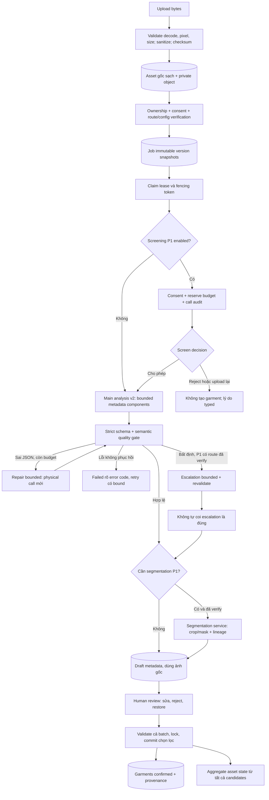
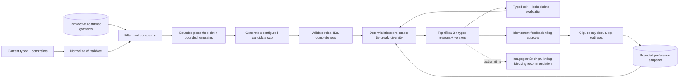

# 03 — Kiến trúc TO-BE: hai pipeline deterministic

## Tóm tắt quyết định

**Trạng thái: DESIGN, chưa phải chứng nhận triển khai/nghiệm thu.** AS-IS và số dòng bằng chứng thuộc commit `52346ec95f53bb29b28a8f48c62efbf8097ce2ab`, trước thay đổi; xem [01](01-vlm-as-is-investigation.md). Chọn một workflow deterministic trên FastAPI → PostgreSQL job → worker hiện có, không thêm hệ multi-agent. [ADR-001](adr-001-deterministic-pipelines.md) so sánh phương án.

1. **A / P0:** ảnh → nhiều metadata candidates v2 → strict quality gate → người dùng sửa/reject/restore → commit tủ đồ có transaction. Không có pixel crop/mask mặc định.
2. **B:** sau nghiệm thu A, tủ đồ active của đúng owner + context typed → bounded generation → deterministic rank Top 3 → typed edits/feedback. Không phụ thuộc image model/key hoặc imagegen job.
3. **P1:** screening/escalation/segmentation là stage có cấu hình, xác minh capability và phê duyệt riêng. Disabled không tạo output giả. Enabled mà thiếu cấu hình phải fail closed, không âm thầm bỏ stage hoặc đổi provider.

## Workflow A và các invariant



### Invariant A

- Không tạo garment khi analysis hoàn tất; `job succeeded` chỉ nghĩa là có draft hoặc `no_items`, không là người dùng đã duyệt.
- Multi-component v2 là metadata độc lập cùng `source_asset_id`; không khẳng định có crop/mask khi segmentation chưa chạy.
- Output model là dữ liệu không tin cậy: strict type, bounded arrays/strings, enum/allowlist và local validation. Null/unknown hợp lệ; chất liệu/fit/kích thước không có bằng chứng không được khẳng định chắc chắn.
- Human edits tách khỏi immutable original attributes; reject/restore không xóa provenance. Chỉ explicit commit mới tạo garment.
- Commit subset không đóng toàn bộ asset nếu còn draft. Request chứa ID sai owner/asset, rejected hoặc dữ liệu sai phải bị từ chối **trước mọi write**; transaction rollback toàn batch. Mixed batch có committed + draft hợp lệ được phép trả lại ID cũ và tạo đúng món mới.
- Fencing token bảo vệ publish DB; worker mất lease không được publish hoặc gửi call kế tiếp. External request đã gửi có thể vẫn chạy, không tuyên bố exactly-once inference.
- Tổng claim attempts, physical model calls, token/chi phí reservation, deadline và repair/escalation đều bounded xuyên retry/reclaim; không reset bằng retry thủ công.

## Sequence A: upload đến tủ đồ

```mermaid
sequenceDiagram
    autonumber
    actor U as Người dùng
    participant A as FastAPI
    participant S as Private storage
    participant D as PostgreSQL
    participant W as Worker
    participant P as Provider được snapshot
    U->>A: POST /v1/assets (file)
    A->>A: Decode, limits, sanitize EXIF, checksum
    A->>S: Put bytes sạch
    A->>D: Insert media asset
    A-->>U: asset_id
    U->>A: POST /assets/{id}/catalogize (provider rõ)
    A->>D: Check owner/consent, lock asset
    A->>A: Validate route configuration; freeze versions/budgets
    A->>D: Asset analyzing + queued job (transaction)
    A-->>U: 202 + job_id
    W->>D: Claim SKIP LOCKED + lease token
    W->>S: Get source bytes
    loop Mỗi physical call, kể cả repair, trong bound
        W->>D: Check consent/lease; reserve quota + insert call started
        D-->>W: Reservation committed trước external IO
        W->>P: Analysis với model/prompt/schema snapshot
        P-->>W: Structured data hoặc lỗi/timeout
        W->>D: Finalize call audit, usage known hoặc unknown
        W->>W: Strict parse + quality gate; không gọi vô hạn
    end
    W->>D: Lock own claim; check consent lại
    W->>D: Save all drafts + job result trong một transaction
    U->>A: GET candidates; PATCH metadata hoặc review decision
    A->>D: Persist current metadata/state, giữ original
    U->>A: POST /assets/{id}/commit (selected candidate IDs)
    A->>D: Lock asset và candidates theo thứ tự; validate mọi ID/state/data
    A->>D: Map allowlist → garments; cập nhật links và aggregate state
    D-->>A: Commit transaction
    A-->>U: garment_ids ổn định; retry không nhân món
    U->>A: GET /garments
    A-->>U: Chỉ món thuộc owner
```

Call audit có transaction riêng để không mất dấu chi phí khi transaction lưu candidate rollback. Hoàn tất audit của call đã phát sinh phải được phép ghi an toàn dù lease cũ đã mất; không cho worker cũ dùng đường này sửa output job/candidates. Quyền ghi audit bó hẹp vào call ID/reservation của chính call đó.

## Routing rõ ràng và configuration/verification gate

Các tên vai trò trong tài liệu nguồn là ý tưởng, **không phải ID được xác minh**. Tài liệu này không chốt hoặc thêm model ID. Không suy ra native structured outputs chỉ vì endpoint tương thích chat.

| Stage | Tuyến được phép | Khi nào gọi | Khi thiếu config/capability | Bound / fallback |
|---|---|---|---|---|
| Main catalogue P0 | `openai` hoặc `fpt` do request/allowlist chọn, model lấy config rồi snapshot | Sau validation/consent; mặc định provider theo contract hiện hữu | Request mới: 503 `provider_not_configured` trước enqueue; job cũ báo lỗi rõ | Repair có trần; cùng provider/model/schema/prompt; **không fallback chéo provider** |
| Azure legacy | Chỉ provider/model/deployment đã có trong snapshot legacy | Xử lý job legacy hợp lệ | Thiếu snapshot/config: dừng, không gán model hiện tại | Không là đích fallback hoặc lựa chọn mặc định mới |
| Screening P1 | Provider/model riêng được allowlist và verify trong stage config | Chỉ khi flag bật và policy yêu cầu | Bật nhưng chưa verify: không nhận job theo route đó | Quyết định typed allow/reject/review; không là security control duy nhất |
| Escalation P1 | Explicit target route, không chọn tự phát bằng LLM | Reason allowlist: ambiguity/conflict đã được quality gate xác định | Nếu stage bắt buộc mà thiếu config: lỗi rõ; route không hỗ trợ thì policy snapshot chọn human review, không giả kết quả | Giới hạn số lần; mọi call có budget; không đệ quy escalation |
| Segmentation P1 | Adapter segmentation riêng đã verify, output pixel-level/crop/mask | Chỉ cần tách asset và có consent/policy phù hợp | Disabled: metadata + ảnh gốc; enabled required nhưng unavailable: trạng thái/lỗi rõ | Không dùng bbox/text VLM làm mask giả; không đổi provider ngầm |
| B explanation/intent optional | Chỉ route text model đã verify; deterministic recommendation không bắt buộc gọi | Hiểu câu lệnh hoặc diễn giải, không chọn IDs ngoài whitelist | Trả structured reasons/typed form nếu tính năng text không bật; lỗi explicit nếu user yêu cầu tính năng bắt buộc | Output phải validate command; không sửa ranking/locks/safety rules |
| Image generation hiện hữu | Action riêng, provider/model/image model snapshot riêng | Sau explicit request tạo ảnh | Thiếu key/model không cản B JSON recommendation | Không tự gọi theo mọi lần rank/edit/feedback |

### Gate triển khai P1

Trước khi bật từng route cần lưu hồ sơ cấu hình có người duyệt và thời gian xác minh:

1. Provider endpoint thuộc allowlist; model/deployment có thật trong tài khoản đúng region/API version; key chỉ ở server.
2. Kiểm chứng input ảnh, giới hạn resolution/bytes, MIME, output tokens, timeout; native structured mode nếu dùng phải được kiểm tra độc lập.
3. Kiểm chứng schema, safety response, usage/request ID semantics, error mapping và retry policy; không mặc định provider A tương đương provider B.
4. Có test adapter mock và integration phù hợp; thử provider tính phí **chỉ sau phê duyệt**, dữ liệu có consent, budget riêng và không log ảnh/key/signed URL.
5. Có version policy, quota, retention, kill switch, compatibility reader và rollback. Verification chưa có → `NOT_VERIFIED`, flag vẫn tắt.

Gate là điều kiện phát hành, không khẳng định các bước trên đã thực hiện.

## B — recommendation deterministic độc lập imagegen



### Thuật toán đề xuất

1. Lấy snapshot garment đã xác nhận thuộc owner, `catalog_status=active`; không dùng draft/rejected/archived hoặc ID của user khác. Chuẩn hóa category legacy về slot; `unknown` không được dùng để vượt hard constraint.
2. Context là typed event/occasion, thời tiết nếu user cung cấp, sở thích và exclusions. Không tự bịa thời tiết/location hoặc thêm external service. Nếu constraint thiếu dữ kiện quan trọng, trả warning/clarification có kiểu.
3. Dùng template hợp lệ (ví dụ nhóm một-piece hoặc top+bottom cùng footwear khi yêu cầu), giới hạn `pool_size_per_slot`, số template và `max_candidates`. Chọn thứ tự ổn định trước truncation; không vật hóa Cartesian product không giới hạn.
4. Hard filter trước scoring: ownership, active, exclusions, slot uniqueness, locked choices, compatibility rules; thiếu món trả `insufficient_wardrobe`, có thể trả <3 lựa chọn. Không tự mua sắm/sáng tạo garment.
5. Điểm `S(o)=Σ w_i·f_i(o,context)+clip(P_u(o),-Pmax,Pmax)`. Features/weights/ranges versioned; missing metadata có penalty/unknown reason minh bạch, không gán certainty giả. Personalization không thể thắng hard constraints.
6. Dedup canonical garment/slot tuple; sort score rồi stable key từ garment IDs/slots; chọn tối đa 3 với diversity policy có bound. Không dùng randomness không snapshot hoặc LLM để quyết định tính hợp lệ.
7. Typed edits (`replace_slot`, `exclude_garment`, `set_context`, `lock_slot`, `unlock_slot`) giữ nguyên locked slots. Muốn đổi locked slot phải unlock explicit; không hiểu yêu cầu thì 422/clarification, không âm thầm chỉnh món khác. Revalidate owner/active tại thời điểm edit/save, không chỉ dựa snapshot cũ.
8. Feedback có request key và payload hash, cập nhật tối đa một lần trong transaction. Preference delta bị clip theo feature, có giới hạn window/decay và version; không ghi đè AI consent hoặc suy diễn thuộc tính nhạy cảm.

Deterministic nghĩa là cùng wardrobe/context/preference/policy snapshot cho cùng output; metadata VLM, thời tiết hay feedback mới tạo snapshot mới có thể cho kết quả khác.

## Audit, budget và xử lý crash

Tái sử dụng hook `before_call` tại baseline `src/garblo/worker.py:154-162`, nhưng nâng contract thành vòng đời call rõ ràng: **reserve → send → record transport outcome → record validation outcome**. Repair cũng là call mới; không chỉ đếm `.analyze()`.

- Reserve trong transaction khóa job/budget counter; kiểm tra lease, consent, `used + reserved < cap`, deadline. Insert call row và debit reservation **commit trước khi gửi request**. Hai worker không thể cùng tiêu slot quota cuối.
- Tắt retry ẩn SDK/HTTP ở đường inference hoặc instrument từng physical retry. Mọi request có thể tính phí phải có ledger row.
- Record duration, stage, attempt, model snapshot, provider request ID nếu có, usage counters đã lọc, transport outcome và validation outcome. Không lưu raw ảnh/prompt output theo mặc định.
- Crash sau reserve trước send không thể phân biệt chắc với crash sau send; giữ `unknown`/reservation bảo thủ, không refund tùy tiện. Tổng claim/call budget tồn tại qua reclaim/manual retry.
- Timeout không có usage không là cost=0. Nếu pricing/usage không đủ, báo `unknown`; còn enforce call count/token reservation. Tiền tệ budget chỉ enforce khi có pricing/cost-bound đủ tin cậy, nếu policy yêu cầu cap tiền mà không có giá thì fail closed.
- Retry chỉ lỗi transient allowlist, exponential backoff + jitter; auth/config/schema failure có xử lý rõ, không vòng lặp vô hạn. JSON repair tối đa theo snapshot riêng nhưng vẫn trừ tổng call cap.
- Consent rút trong request đang chạy: không thể thu hồi external call; giữ audit tối thiểu, bỏ candidate/output publish, không gửi call tiếp.

## Công thức chi phí và latency — chưa có số đo

Không có giá, benchmark hoặc tỷ lệ thực nghiệm trong báo cáo này. Mọi biến dưới đây phải được cấu hình/xác minh theo provider và đo trên tập ảnh đã có quyền sử dụng.

Với physical call `k`, giá có version theo provider/model/currency/thời điểm:

```text
C_k = (T_input_text,k * P_input_text,k
       + T_input_image,k * P_input_image,k
       + T_output,k * P_output,k) / price_unit
      + fixed_fee_k

C_job_observed = Σ C_k (mọi call, gồm repair/retry/escalation/lỗi có usage)
                 + C_segmentation + C_storage + C_infrastructure
```

Nếu image tokens đã nằm trong tổng input billed tokens, dùng pricing tương ứng **một lần**, không cộng image tokens lần nữa. Cached tokens hoặc per-image pricing phải theo billable schema provider; không tự áp dụng công thức text cho ảnh. Thiếu usage/giá → chi phí quan sát chưa đầy đủ, không gắn nhãn số chính xác.

Để lập kế hoạch, với `S` là flag screening, `r_reject` tỷ lệ bị loại sau screening, `r_e` escalation rate, `r_seg` segmentation rate:

```text
E[C/image] = S * E[C_screen]
  + (1 - S*r_reject) * (E[C_main] + r_e*E[C_escalate] + r_seg*E[C_segment])
  + E[C_repair/retry] + E[C_storage/infra]
```

Các tỷ lệ chưa đo được giữ dưới dạng biến, không điền giả định thành kết quả. Không cộng `retry cost` lần hai nếu đã tính tổng mọi physical calls.

```text
L_job = L_queue + L_storage + Σ L_physical_call
        + Σ L_backoff + L_validate + L_db + L_optional_segmentation
L_to_wardrobe = L_upload + L_job + L_human_review + L_commit
```

Không cộng p95 từng stage để gọi là p95 end-to-end; phải đo distribution tổng theo job. Tách queue/compute/human time. Worst-case operational bound dựa call cap × timeout + backoff cap + bounded storage/DB time; network hang/lease policy phải được test.

### Chỉ số cần đo

- Cost/image với coverage usage; số call/job theo stage và outcome; unknown/reservation rate; reject/escalation/repair/retry/segmentation rates.
- Latency p50/p95 end-to-end và từng stage; queue age, lease expiry, stale-output discard.
- Component precision/recall trên dữ liệu gán nhãn; attribute accuracy chỉ trên trường quan sát được; schema validity trước/sau repair; human correction/reject/restore rate; duplicate garment count.
- B: hard-constraint violation count, cap adherence, reproducibility, Top-3 diversity/acceptance theo tập review có protocol; feedback replay count và personalization saturation.

Không log PII/ảnh/key/signed URL vào traces; dùng IDs có kiểm soát cardinality, retention và access scope. Đo chất lượng/cost thật là gate riêng, không suy ra từ mock tests.
