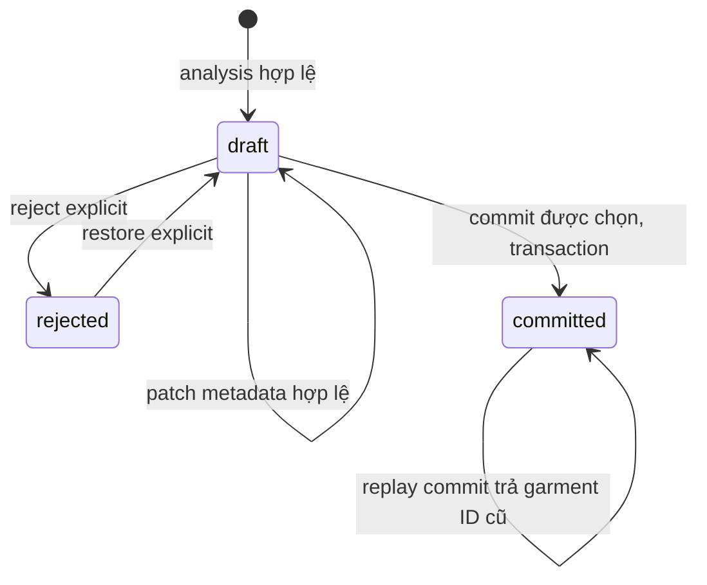

# 04 — Đề xuất contract dữ liệu, API và migration additive

## Trạng thái và nguyên tắc tương thích

**DESIGN — tên trường/bảng/route mới dưới đây là đề xuất, không phải OpenAPI đã phát hành.** Đối chiếu contract triển khai và báo cáo nghiệm thu riêng của main agent trước khi tích hợp. AS-IS tham chiếu commit `52346ec95f53bb29b28a8f48c62efbf8097ce2ab`, trước thay đổi; `src/garblo/schemas.py:85-127` và `src/garblo/ai_providers/contracts.py:15-28` là contract cũ.

- Giữ prefix `/v1`, shape phẳng category/color/material/season/tags, `candidate_ids`, `garment_ids`, job polling và provider selection hiện hữu khi không có lý do breaking.
- Phân biệt **API version** với **VLM schema version**: metadata v2 không buộc đổi mọi endpoint thành `/v2`.
- Chỉ thêm field nullable/default có compatibility reader. Candidate/job legacy đọc bằng v1; không ép job cũ chạy prompt/schema mới. Response có field mới không có nghĩa client cũ đã hiển thị được.
- Reject/restore là quyết định review, không được trộn tùy tiện vào attributes model; garment archive khác candidate reject.
- UUID/string ID phải được validate theo contract API cuối cùng; luôn kiểm tra owner và quan hệ asset/job ở server, không chỉ tin format.

## A1. Contract model v2 đề xuất

Ví dụ minh họa metadata (không phải kết quả inference, không chứa model ID):

```json
{
  "schema_version": "2",
  "items": [
    {
      "category": "shirt",
      "color": "blue",
      "material": null,
      "season": null,
      "tags": ["casual"],
      "details": {
        "subcategory": null,
        "secondary_colors": [],
        "pattern": null,
        "fit": null,
        "style": ["casual"],
        "seasons": [],
        "uncertain_fields": ["material", "details.fit"],
        "needs_review": true
      }
    },
    {
      "category": "trousers",
      "color": "black",
      "material": null,
      "season": null,
      "tags": [],
      "details": {
        "subcategory": null,
        "secondary_colors": [],
        "pattern": null,
        "fit": null,
        "style": [],
        "seasons": [],
        "uncertain_fields": ["material", "details.fit"],
        "needs_review": true
      }
    }
  ]
}
```

Đây là nhiều metadata từ cùng ảnh, **không phải** hai ảnh đã segment. Không có `confidence` giả, kích thước cơ thể hay kết luận chất liệu chắc chắn. `shirt`, `trousers`, màu và style là ví dụ giá trị cần đối chiếu allowlist cuối cùng, không chốt taxonomy toàn sản phẩm.

### Quy tắc Pydantic/JSON Schema cần thực thi

| Model/field | Bắt buộc/nullable/default | Ràng buộc đề xuất |
|---|---|---|
| Root `schema_version` | Bắt buộc với v2, literal version; v1 parser riêng | Không nhận version lạ; `extra=forbid`, strict |
| `items` | Bắt buộc, list; rỗng là no_items | `0..MAX_COMPONENTS`, cap cứng phía server và snapshot; không cắt bớt âm thầm output vượt cap |
| Item category/color/material/season | Giữ các field v1 bắt buộc trong output, nullable | Chuỗi không rỗng, giới hạn 80 như AS-IS hoặc taxonomy đã duyệt; không coercion number/bool thành string |
| `tags` | Bắt buộc trong model output; không nullable | List string bounded, giới hạn số lượng/độ dài, canonical dedup nếu policy cho phép |
| `details` | Bắt buộc trong v2 output, object strict | Không chấp nhận arbitrary nested dict; compatibility v1 dùng default object/nullable có version rõ |
| subcategory/pattern/fit | Có key trong v2 output, nullable | Allowlist theo taxonomy hoặc text bounded đã duyệt; material/fit không suy đoán quá bằng chứng |
| secondary_colors/style/seasons | Có key, list không nullable | Số lượng/độ dài bounded, taxonomy versioned, không arbitrary object |
| `uncertain_fields` | Có key, list không nullable | Enum đường dẫn allowlist, dedup, bound; không chấp nhận tên trường tùy ý |
| `needs_review` | Bắt buộc boolean strict | Không nhận `"false"`, `0`, `1`; uncertainty chưa giải quyết buộc review theo policy |

`null` nghĩa là chưa biết/không đủ bằng chứng; list rỗng là không có giá trị được xác định, không phải xác nhận không tồn tại thuộc tính. Không sử dụng score model tự khai là calibrated probability. Nếu sau này thêm confidence, phải có nguồn/calibration/version, nullable và không dùng để bỏ qua human approval.

Native structured output là khả năng adapter có thể dùng sau khi xác minh provider; local schema/semantic validation luôn chạy. Không chỉ tin JSON parse được. `additionalProperties: false`, required keys, null union, giới hạn arrays/strings và strict bool/type phải được kiểm thử từ JSON Schema đến Pydantic. Prompt/schema/policy cần đồng bộ version.

### Patch và merge semantics

- Candidate patch là partial: omitted = giữ nguyên; scalar `null` = xóa thành unknown nếu field nullable. `tags: []` = xóa tags, không gửi tags = giữ tags. `tags: null` phải 422.
- Nested details dùng **field-aware merge**, không shallow replace toàn details làm mất uncertainty hay thuộc tính khác. Unknown nested key/đường dẫn uncertainty sai/type sai phải 422; validate toàn candidate sau merge trước persist.
- Thay category làm subcategory/slot không còn tương thích phải báo lỗi hoặc clear theo policy explicit; không giữ mâu thuẫn im lặng.
- User-confirmed value khác AI original cần provenance/review state; không tự xóa mọi uncertainty chỉ vì patch một trường. Quy tắc resolve uncertainty và needs_review phải được chốt, có test riêng.
- `attributes_json` không nhận status/garment ID/provider từ patch. Khi commit, dựng ORM bằng allowlist fields và gán details vào cột riêng, không `**arbitrary_json`.

## A2. State machine review và commit



- Reject/restore cùng quyết định hiện tại nên idempotent, không nhân event/update side effect; reject/restore committed trả 409, không xóa garment qua candidate.
- Candidate rejected không được commit hoặc sửa trực tiếp, trừ khi contract cuối cùng cho phép hành vi khác có test; đề xuất restore trước khi patch.
- Asset state là aggregate, không phải flag do client đặt. Ví dụ đề xuất: không có candidate → `no_items`; có draft → `analyzed`/`partially_committed` tùy có món đã commit; không còn draft và có committed → `catalogued`; tất cả rejected → `reviewed_rejected`. **Tên state cuối cùng cần thống nhất trong implementation**, invariant là không che khuất draft còn lại.
- Commit chọn subset để sau tiếp tục review/commit phần còn lại. Dedupe request IDs giữ thứ tự phản hồi ổn định. Toàn request có một ID sai/rejected/dữ liệu không hợp lệ → không tạo bất kỳ garment nào.
- Khóa asset trước rồi candidates theo thứ tự ID; kiểm tra state toàn batch, chuẩn hóa/validate attrs, map ORM, flush links, cập nhật aggregate và commit. Retry cùng IDs trả cùng garment IDs; concurrent overlap không nhân garment.
- Với dữ liệu legacy/corrupt, schema validation lỗi phải 409/422 có error code thống nhất, không 500 do Python expansion hoặc ORM unknown field.

## A3. API delta additive đề xuất

| Endpoint | Trước (baseline) | Sau đề xuất | Compatibility/error |
|---|---|---|---|
| `POST /assets` | Upload/sanitize/checksum | Giữ nguyên P0 | Không đổi upload thành AI call; checksum là bytes đã chuẩn hóa |
| `POST /assets/{id}/catalogize` | Provider optional OpenAI/FPT, job/model snapshot | Giữ body cũ; server chọn schema/pipeline/prompt/budget snapshot theo release policy | Provider không hợp lệ 422; missing config 503 trước enqueue; same asset conflict giữ 409 |
| `GET /jobs/{id}` | status/output_ref/provider/model/attempts | Thêm version và budget/audit summary sanitized nếu cần client | Không trả key/raw prompt/ảnh; attempts khác physical call count; unknown usage hiển thị unknown |
| `GET /assets/{id}/candidates` | Current attributes/status/garment link | Thêm details/version/review flags, revision nếu áp dụng | Candidate legacy vẫn đọc được; không đổi tên ID sẵn có |
| `PATCH /candidates/{id}` | Flat metadata | Flat + strict nested details theo field-aware merge | Extra/type invalid 422; committed/rejected 409; owner 404 |
| `POST /candidates/{id}/review` **mới** | Không có | Body `{"decision":"reject"}` hoặc `{"decision":"restore"}`; trả candidate | Route và verb là đề xuất; không giả định backend đang có endpoint này |
| `POST /assets/{id}/commit` | Chọn candidate IDs, idempotent committed IDs | Giữ body/`garment_ids`; whole-batch validation + aggregate partial state | Invalid owner/asset 404; rejected/state 409; không partial write |
| `GET/PATCH /garments` và `/{id}` | Flat attrs, active/archived | Thêm details/version nếu cần; patch strict và server-owned provenance | Existing IDs/fields không đổi; archive không phải xóa |
| Audit detail **internal trước** | Không có call ledger | Operator query/service role; public API chỉ owner-scoped summary nếu thật sự cần | Không public raw responses, prompt hoặc request header |

Review endpoint là một phương án dễ tách trạng thái khỏi metadata; main agent có thể chọn action routes riêng reject/restore nếu giữ nguyên invariant và ghi OpenAPI cuối cùng. Không để tài liệu thiết kế bị hiểu là contract đã có.

## A4. Snapshot và DB migration additive

### Version snapshot bất biến

Giữ provider/model/request time hiện hữu (`src/garblo/jobs.py:30-39`), thêm các khóa server-owned vào `input_ref` hoặc cột tương đương:

```text
schema_version, prompt_version, pipeline_version, taxonomy_version,
quality_policy_version, routing_policy_version,
provider, model, image_model (nếu thật sự là imagegen),
max_components, max_physical_calls, max_repairs, max_escalations,
max_reserved_tokens, money_budget/currency/pricing_version (nếu có),
timeout/deadline policy, enabled stages và các route stage snapshot
```

Không để client tùy ý gửi model/key/prompt/budget để vượt allowlist. Snapshot phải chỉ tới prompt/schema implementation còn hỗ trợ khi retry; chỉ lưu nhãn version mà runtime luôn lấy prompt mới là không đủ. Version không hỗ trợ → lỗi rõ, không silently upgrade. Legacy thiếu provider/model không được tự gán snapshot hiện hành.

### Bảng/cột đề xuất

| Đối tượng | Thay đổi additive | Backfill/constraint |
|---|---|---|
| `garment_candidates` | Có thể giữ details trong current/original JSON; thêm schema version/revision/review provenance có giới hạn nếu cần | Original không bị patch; unique `(job_id,candidate_index)` giữ nguyên; legacy version đánh dấu v1 bằng migration/reader có policy rõ |
| `garments` | `details_json` nullable/default object, metadata schema version; optional `source_candidate_id` unique | Existing flat columns giữ; không tự suy diễn details từ null legacy; candidate link có thể nullable cho garment cũ |
| `ai_jobs` | Persistent physical-call counter/token reservations và versioned budget snapshot; audit là source of truth | Không reset khi retry; updates có lock hoặc atomic conditional update; counter và ledger insert cùng transaction |
| **`ai_model_calls` mới** | `id`, `job_id`, `user_id`, `sequence_no`, `stage`, `worker_attempt`, `claim_token`, provider/model/version snapshot, request time/completion/duration, transport/validation outcome, safe error code, provider request ID, usage counters nullable, reservations, estimated/actual cost nullable + currency/pricing version | Unique `(job_id,sequence_no)`; counters không âm; indexes job/time/outcome; không dùng provider request ID làm unique toàn provider nếu chưa verify semantics |
| `media_assets` P1 | Optional `parent_asset_id`, `derived_kind` crop/mask, processing/version/region metadata bounded | FK owner consistency kiểm tra service; source checksum và coordinate space rõ; không backfill mask giả |
| Dedup P1 | Idempotency/dedup record scoped owner + normalized checksum + provider/model/prompt/schema/pipeline | Không unique checksum toàn hệ thống; không tiết lộ ảnh người khác; explicit force/new analysis là action riêng có budget |

Các cột tiền tệ nên dùng decimal/integer minor units và currency, không float. Usage missing giữ nullable; distinction input/output/image/cached theo provider, không ép counter không rõ về 0. Không lưu raw provider body để “audit” mặc định; nếu cần điều tra nâng cao, dùng cơ chế opt-in, encryption, retention/access policy riêng.

### Migration và rollback

1. Thêm **revision mới sau head hiện hữu**, không sửa `20261018_0001` hoặc giả định số revision của thay đổi main agent. Baseline head là `20261030_0002` (`migrations/versions/20261030_0002_providers_candidates_recovery.py:10-11`).
2. Expand: thêm cột nullable/default và bảng mới; triển khai reader hiểu v1/v2 trước hoặc đồng thời với writer, theo maintenance window/rollout đã duyệt.
3. Backfill từng batch nếu cần, idempotent, không rewrite AI originals hoặc đoán metadata. Validate constraints trước khi siết NOT NULL.
4. Test upgrade trên PostgreSQL test từ baseline có dữ liệu legacy và DB trống; kiểm tra locks/indexes/unique/concurrency, không chỉ SQLite `create_all`.
5. Rollback ưu tiên tắt writer v2/P1/B và dừng dequeue job version không hỗ trợ, giữ dữ liệu/call ledger. Binary cũ không chắc đọc được JSON v2 `extra=forbid`; phải dùng compatibility release hoặc pin traffic/job versions, không chỉ rollback image ứng dụng.
6. Không downgrade drop table/cột audit trên DB thật khi đã có dữ liệu mới; export/backup/retention và kế hoạch forward-fix được duyệt trước. Downgrade destructiveness chỉ kiểm tra trên DB test dùng riêng.

## B1. API và dữ liệu đề xuất — sau nghiệm thu A

Không thay route lookbook imagegen hiện có thành recommendation một cách ngầm định. Các route dưới đây là đề xuất riêng:

| Endpoint đề xuất | Request | Response và invariant |
|---|---|---|
| `POST /recommendations` | Typed context, exclusions, optional locked slot IDs, request/idempotency key | Session ID, snapshot/policy versions, tối đa 3 outfits; mỗi outfit gồm slot→garment ID, score breakdown/reasons typed, warnings; không có món ngoài own active wardrobe |
| `GET /recommendations/{id}` | Session thuộc owner | Stored snapshot/result; không nhận ID session của user khác |
| `POST /recommendations/{id}/edits` | Discriminated union typed edit + base revision + idempotency key | Revision mới, giữ locked slots; stale revision 409; không hợp lệ/không đủ món trả lỗi/warning rõ, không tự unlock |
| `POST /recommendations/{id}/feedback` | Outfit ID trong session, signal enum, idempotency key | Stable feedback ID, replay không cập nhật preference lần nữa; payload đổi cùng key 409 |
| Preference controls | Typed opt-out/reset theo API được phê duyệt | Phiên bản preference mới, không ảnh hưởng ownership/consent AI |

Typed edits đề xuất: `replace_slot(slot, replacement_garment_id?)`, `exclude_garment(garment_id)`, `set_context(context_patch)`, `lock_slot(slot)`, `unlock_slot(slot)`. Body mỗi command `extra=forbid`; không arbitrary tool name/SQL/prompt. Auto-replacement chỉ chọn từ bounded eligible pool và không đổi slot khác ngoài policy explicit. LLM chuyển ngôn ngữ tự nhiên thành command là optional, cần preview/validation; không phải quyền thực thi trực tiếp.

### DB B đề xuất

- `recommendation_sessions`: owner, context/wardrobe/preference snapshots hoặc immutable references, versions, revision, constraints, locked slots, status; không cần FK generated image.
- `recommendation_outfits`/items: canonical stable key, rank, score breakdown, slot→garment FK; snapshots giữ provenance nếu garment sau đó archive. Khi edit/save phải revalidate active hiện tại; lịch sử có thể hiển thị unavailable, không coi garment cũ vẫn eligible.
- `recommendation_feedback`: owner/session/outfit/signal; unique `(user_id, idempotency_key)` hoặc scope được công bố, canonical payload hash. Session/outfit ownership được kiểm tra trước khi nhận feedback.
- `style_preferences`/events: bounded feature deltas, window/decay/policy version, last applied event, opt-out/reset version. Insert feedback + apply delta trong một transaction hoặc consumer idempotent có applied marker; không double-apply sau crash.
- Giữ `StyleSignal` legacy để tương thích; không gộp feedback cũ trùng lặp vào training/personalization mà không có dedup/migration policy đã duyệt. Approval hiện hữu không bị chuyển thành feedback.

## Đề xuất compatibility FE — không sửa frontend

Theo hướng dẫn workspace, frontend demo IndexedDB là hệ riêng; endpoint backend tồn tại **không đồng nghĩa FE đã tích hợp**. Tài liệu này không khảo sát hoặc sửa FE và không khẳng định có real-mode integration.

Đề xuất cho lượt tích hợp riêng:

1. Giữ tên flat attrs cũ, hiển thị thêm details/uncertain fields bằng nhãn tiếng Việt; unknown là “Chưa xác định”, không biến thành giá trị đã xác nhận.
2. Poll job đến terminal, rồi đọc candidates; “Phân tích xong” khác “Đã thêm vào tủ”. Multi-item dùng checklist/review từng candidate; reject/restore không xóa ảnh gốc.
3. Commit các ID được chọn; reload state server sau timeout/retry thay vì tự nhân item trong state FE. Partial asset còn draft phải vẫn mở review được.
4. Không hiển thị crop/mask giả khi backend chỉ có source image. Badge “Đã tách ảnh” chỉ khi có derived asset thật và lineage hợp lệ.
5. B dùng màn JSON/outfit recommendation độc lập nút tạo ảnh; khóa slot có trạng thái rõ. Feedback double-click/network retry dùng cùng key; payload mới dùng key mới theo contract.
6. Chuẩn bị error mapping 404/409/422/503 và unknown budget/cost; không đưa provider keys vào `VITE_*`. Trước tích hợp phải đối chiếu OpenAPI triển khai, FE repository và consent/privacy UX, rồi kiểm thử riêng cả hai phía.
