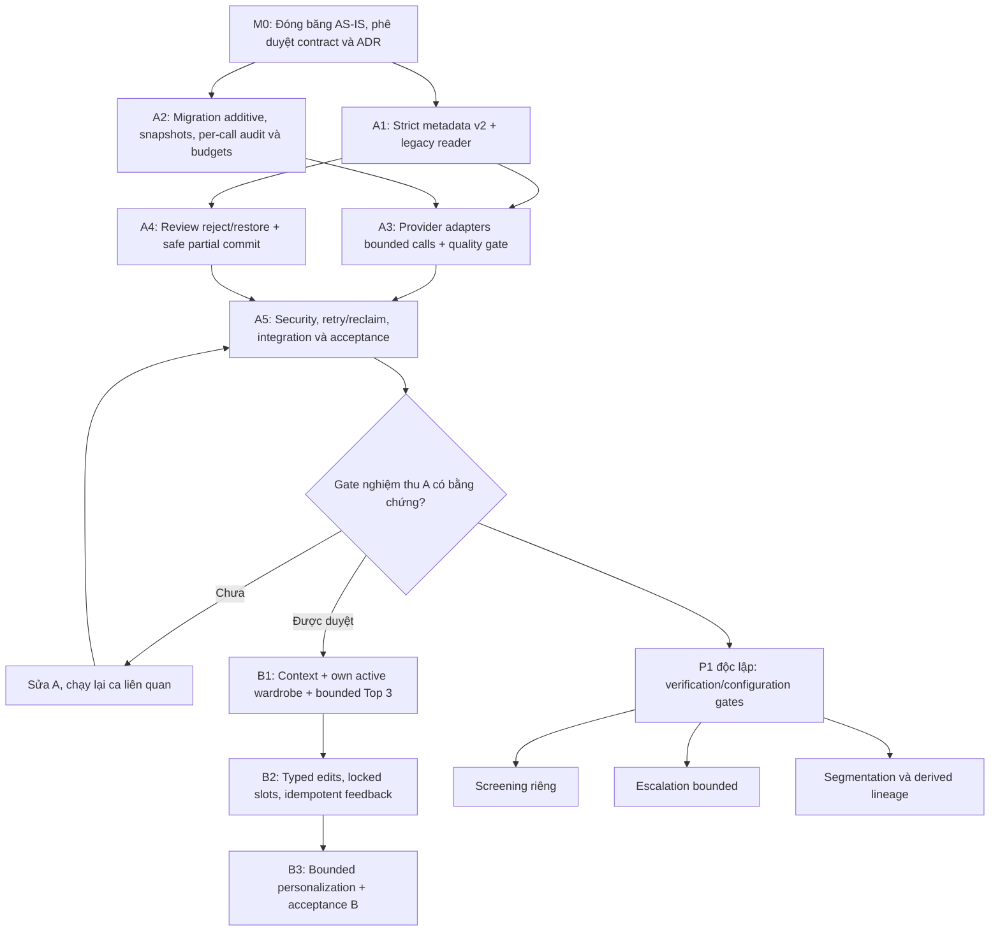

# 05 — Kế hoạch triển khai, gate, rủi ro và rollback

## Trạng thái và phạm vi

**Đây là kế hoạch DESIGN, không phải nhật ký triển khai hoặc nghiệm thu.** Main agent đang thực thi A; tài liệu không suy ra đã hoàn thành. AS-IS tham chiếu commit `52346ec95f53bb29b28a8f48c62efbf8097ce2ab`, trước thay đổi. Chỉ cập nhật kết quả thực tế vào báo cáo nghiệm thu riêng sau kiểm thử; không ghi đè lịch sử AS-IS.

Thứ tự bắt buộc: **khảo sát → thiết kế A → triển khai A → nghiệm thu A → quyết định mở B → triển khai/nghiệm thu B**. P1 screening/segmentation/escalation không được lấy thời gian hoặc làm hỏng luồng P0. Không thêm VTON, multi-agent framework, mua sắm hoặc tích hợp FE trong phạm vi này.

## Dependency graph và milestone

“Được duyệt” là điều kiện kế hoạch, không phải trạng thái hiện tại. Không đưa thời lượng cố định khi chưa có nguồn lực/dataset/provider access được xác nhận.

## P0/A — tasks và tác động thay đổi

Mỗi hàng là **đề xuất**; module mới có thể được tách theo style codebase khi triển khai, không bắt buộc đúng tên service gợi ý. Chi tiết contract ở [04](04-vlm-data-contracts.md), acceptance IDs ở [06](06-vlm-test-strategy.md).

| Task, dependency | Lý do; trước → sau | File/module liên quan | API/DB và compatibility | Rollback an toàn | Kiểm chứng |
|---|---|---|---|---|---|
| A1.1 taxonomy/schema v2; sau M0 | Một item phẳng → bounded multi metadata + strict details/uncertainty, không giả segmentation | `src/garblo/ai_providers/contracts.py`, `src/garblo/schemas.py` | Giữ flat fields, thêm version/details; v1 parser riêng; client cũ có thể không hiển thị field mới | Tắt writer v2 cho job mới, giữ v1/v2 reader; không chạy parser cũ trên JSON v2 | A02–A04 |
| A1.2 patch/response compatibility; sau A1.1 | Flat merge → nested field-aware merge và validation sau merge | `src/garblo/api/routes.py`, `src/garblo/schemas.py` | PATCH omitted/null/list rõ; original/current không lẫn; revision optional | Route compatibility release, không xóa original/details đã ghi | A03–A06 |
| A2.1 additive DB; sau M0 | Không có garment details/call ledger → cột/bảng additive | `src/garblo/models.py`, **migration mới** | Nullable/default cho legacy, giữ unique candidate/garment; counter constraints | Giữ expanded schema; không drop ledger/cột có dữ liệu thật | A08, A09, A11; migration PostgreSQL |
| A2.2 immutable snapshots; sau A1.1/A2.1 | Provider/model/time → thêm prompt/schema/pipeline/policy/budget versions | `src/garblo/jobs.py`, `src/garblo/api/routes.py`, worker dispatch | New job chọn version mới; retry cũ không đổi model/prompt/schema; unsupported version fail rõ | Dừng dequeue version không hỗ trợ, pin binary/registry reader; không rewrite queued snapshot | A09 |
| A2.3 physical-call ledger/budget; sau A2.1 | Chỉ claim attempts/final usage → reserve từng request trước IO, finalize known/unknown | Worker + provider call lifecycle; service audit/budget có thể tách riêng | Persistent quota xuyên retries; summary sanitized additive; tiền cần pricing version | Kill switch inference mới, giữ reservations/audit; không reset counter để chạy lại | A10, A11 |
| A3.1 provider prompt/parser; sau A1/A2 | Prompt một món + repair ít quan sát → v2 structured output validated, từng repair trừ quota | `src/garblo/ai_providers/openai_direct.py`, `fpt_qwen.py`, `registry.py` | Request provider selection giữ; model ID không hardcode mới; native schema mode cần verify | Pin version route; không đổi provider khi lỗi; lỗi config rõ | A02–A04, A09–A11 |
| A3.2 worker publish; sau A3.1 | Draft một item → lưu N candidates transaction + version/provenance | `src/garblo/worker.py` | Unique `(job,index)` giữ; no_items không tạo món; lease/consent giữ trước call/persist | Stop workers, giữ job/output/call evidence; resume bằng version-compatible worker | A05, A08–A12 |
| A4.1 reject/restore; sau A1.2/A2.1 | Draft/committed → thêm rejected và restore explicit | `src/garblo/api/routes.py`, `src/garblo/schemas.py` | Action endpoint additive; không làm status thành free-form metadata | Tắt UI/action mới nếu cần; không tự restore rejected khi rollback | A05, A06 |
| A4.2 safe partial/idempotent commit; sau A4.1 | Always catalogued và JSON expansion → allowlist mapping, validate batch trước writes, aggregate state đúng | `src/garblo/api/routes.py`, persistence service nếu tách | Giữ body và ordered garment_ids; state additive cần FE mapping; DB locks/unique giữ | Dừng commit traffic khi có corruption; forward-fix, không xóa garment người dùng | A07, A08 |
| A5.1 security và evidence; sau A3/A4 | Test source hiện hữu → regression + acceptance/integration rõ environment | `tests/`, test-only fixtures/config; docs nghiệm thu riêng do main agent | Không dùng dữ liệu production; không log secrets | Kill switch và rollback rollout theo risk register | A01–A12 |

### Gate nghiệm thu A

Chỉ mở B sau khi người chịu trách nhiệm xác nhận đủ bằng chứng tương ứng phạm vi phát hành:

1. Contract v2 và compatibility v1 rõ, multi candidate không được gọi là segmentation.
2. Strict schema/details/uncertainty; wrong types/extra keys/overflow không lọt vào DB; no_items không tạo garment.
3. Review sửa/reject/restore durable; commit partial/idempotent/whole-batch invalid rollback; concurrency PostgreSQL không nhân món.
4. Mỗi physical request có audit, repair/retry không vượt persistent budget; crash/timeout unknown không bị ghi cost 0 hoặc refund vô căn cứ.
5. Snapshot giữ đúng provider/model/schema/prompt/pipeline/policy xuyên retry; không implicit fallback.
6. Ownership, consent revocation trước và trong call, lease fencing, privacy và rollback được kiểm thử.
7. Báo cáo riêng ghi rõ ca đã chạy/chưa chạy/skip, command/exit code, revision và môi trường. Mock tests không thay thế migration PostgreSQL, storage integration hoặc provider capability verification. Nếu thiếu bằng chứng cần thiết, gate giữ đóng hoặc người duyệt ghi rõ phạm vi giới hạn, không gắn nhãn nghiệm thu rộng hơn.

## B — chỉ sau gate A

| Task/dependency | Trước → sau; lý do | Module/API/DB đề xuất | Compatibility/rollback | Kiểm chứng |
|---|---|---|---|---|
| B1.1 typed context và wardrobe read; sau nghiệm thu A | Lookbook chọn ID trực tiếp → context normalization + own active query | Service recommendation/context, schema/routes mới | Không đổi lookbook imagegen; tắt route B giữ A | B01 |
| B1.2 bounded generation và ranking; sau B1.1 | Không có selector → slot templates, caps, deterministic score/top tối đa 3/diversity | Pure functions/service, policy snapshot; recommendation session/result additive | Giữ policy cũ để replay; không tăng caps không đo; flag off không tạo outfit giả | B02, B03, B07 |
| B2.1 typed edits/locks; sau B1.2 | Variation prompt bị khóa → commands discriminated union + locked slots | Routes/schema edits mới, revision/locks trên session | Không mở lại free prompt variation; disable edits giữ history | B04 |
| B2.2 feedback idempotent; sau B1.2 | Append mỗi request → unique key+hash và one-time apply | Feedback table/route mới; không đổi approval | Giữ events, ngừng preference consumer khi lỗi; không xóa like/dislike thật | B05 |
| B3.1 bounded personalization; sau B2.2 | Chưa có ranker đọc signal → clipped/decayed/versioned deltas | Preference service/state/events; opt-out/reset | Tắt contribution personalization về 0, giữ event và audit; replay cần policy đúng | B06 |
| B3.2 acceptance B; sau B2/B3.1 | Chưa có benchmark → invariant/property/quality review có protocol | Tests mới + báo cáo riêng | Gate không mở khi hard rules sai; no imagegen dependency | B01–B07 |

## P1/P2 và gate cấu hình

| Hạng mục | Dependency và lý do | Tác động API/DB | Gate/rollback | Test |
|---|---|---|---|---|
| P1 screening | A audit/budget + capability verification; giảm xử lý ảnh unsuitable | Stage snapshot/decision typed; có thể status/error code mới | Disabled mặc định; enabled thiếu verification/config phải fail closed; tắt flag cho job mới, giữ policy job cũ | P101 |
| P1 escalation | A quality gate + reason taxonomy + verified route; giải ambiguity có bound | Audit stage/reason/model snapshots, không đổi garment approval | Trần escalation/call cap; không fallback provider ngầm; vẫn human review | P103 |
| P1 segmentation thật | A metadata + adapter verified + storage lineage/privacy; có asset riêng để tái sử dụng | parent/derived relationships, crop/mask + coordinate/version metadata | Không có service thì metadata-only rõ; không ghi mask giả; stop stage/garbage collect orphan có scope | P102 |
| P1 dedup | A versions/checksum; giảm phân tích lặp đúng scope | Dedupe/idempotency record owner-scoped | Tắt cache lookup không xóa dữ liệu; không reuse sai version/provider; không lộ cross-user | P104 |
| P1 observability/cost | A ledger; mở rộng dashboards theo measured usage | Pricing version/retention config, không raw prompts | Giới hạn access/cardinality; tắt exporter không mất core ledger | A10, A11, P105 |
| P2 learning/evaluation nâng cao | Dataset correction đã được phép, evidence A/B | Cần ADR mới cho feature/ranker thay đổi | Offline trước, shadow khi được duyệt; không thay hard rules | Protocol riêng, không coi correction tự động là ground truth |
| P2 dynamic routing/agent framework | Chỉ khi đo được hạn chế deterministic flow và có use case thực | ADR mới về quyền tool, state, cost/replay | Không thuộc MVP; không thêm framework chỉ để gọi tuần tự model | Test budget/ownership/policy và differential replay |

Chi tiết verification gate tại [03](03-vlm-to-be-architecture.md): provider/model access, image/schema capability, error/usage semantics, authorized spend, privacy, kill switch. Không chốt model ID chưa xác minh.

## Risk register

| ID / mức | Rủi ro và dấu hiệu phát hiện | Giảm thiểu / chủ trách nhiệm đề xuất | Rollback/containment |
|---|---|---|---|
| R01 cao | Model đoán chất liệu/fit hoặc bỏ món; tăng human correction | Backend/AI: null+uncertainty, strict schema, dataset có nhãn và review bắt buộc | Tắt route/prompt version mới cho job mới; giữ metadata gốc và review history |
| R02 cao | Multi metadata bị UI/tài liệu hiểu là segmentation | Backend/product: source-vs-derived fields rõ, badge theo asset thật | Ẩn capability segmentation, không tạo crop placeholder |
| R03 cao | Partial commit làm mất draft hoặc nhân garment khi concurrent | Backend/DB: whole-batch validation, aggregate states, lock order, unique, PostgreSQL tests | Dừng endpoint commit/worker publish liên quan; giữ dữ liệu, forward-fix có audit |
| R04 cao | Repair/SDK retry tạo chi phí không đếm | Backend/AI: instrument physical IO, disable hidden retries, reservation atomic | Kill switch inference, giữ unknown reservations; không reset budget |
| R05 cao | Crash giữa reserve/send/finalize hoặc stale worker gây call mơ hồ | Backend/DB: durable ledger, fencing, unknown outcome, provider idempotency chỉ khi verify | Không tự replay vô hạn/refund; reconcile operator có audit trong cap |
| R06 cao | Retry job cũ chạy schema/prompt/model mới | Backend: version registry + immutable snapshots, fail unsupported | Pin compatible worker, dừng version không hỗ trợ; không rewrite job silently |
| R07 cao | Lộ ảnh/key/signed URL/raw output qua log/audit/traces | Security/ops: safe counters/IDs, scrub errors, private storage, retention/access | Tắt exporter, rotate/revoke key khi lộ theo incident process; purge có phê duyệt |
| R08 cao | Thu hồi consent trong call đang chạy | Backend/privacy: check trước mọi call và trước publish; không gửi call tiếp | Bỏ output persist, giữ audit tối thiểu; không tuyên bố thu hồi request bên provider |
| R09 cao | ID không thuộc owner hoặc archived lọt vào B | Backend: owner+active hard filter và revalidate edit/save | Tắt B, giữ sessions phục vụ điều tra; không chọn hàng thay thế ngoài tủ |
| R10 trung bình | Cartesian explosion hoặc score tie làm output không ổn định | Backend: cap pools/templates/candidates trước materialization; stable tie-break | Giảm caps/policy version mới sau đo; rollback ranker giữ snapshot |
| R11 trung bình | Duplicate feedback/abuse làm personalization lệch | Backend/product: unique key+payload hash, bounded window/clip/decay, one-time apply, opt-out/reset | Đặt personalization contribution=0, giữ events; rebuild từ events hợp lệ có version |
| R12 cao | Model endpoint/ID không hỗ trợ ảnh/native schema hoặc không có quyền | AI/ops: configuration+verification gate riêng từng stage/provider | Không enqueue tuyến chưa ready; giữ stage off, không provider fallback |
| R13 cao | Rolling deploy binary cũ không đọc v2, migration rollback mất ledger | Backend/ops: expand/contract, dual readers, drain/pin versions, backup | Giữ schema additive, rollback bằng compatibility release; không drop cột/bảng thật |
| R14 trung bình | Storage write thành công/DB lỗi tạo orphan; derived purge thiếu | Backend/ops: scoped orphan reconciliation với age/owner/job marker, retention policy | Dừng segmentation/generation nếu cần; chỉ xóa object xác minh orphan, không broad delete |
| R15 trung bình | Tài liệu design bị hiểu là contract hoặc số liệu thực nghiệm | Tech Lead: nhãn DESIGN/AS-IS, acceptance report riêng, no giả giá/benchmark | Sửa tài liệu và thông báo phạm vi; không nâng trạng thái chỉ vì có code/test source |

## Quy trình rollout/rollback đề xuất

1. Chốt contract và flags/caps trước writer mới. Backup/restore thử trên tài nguyên test riêng; không chạy migration production từ lượt báo cáo.
2. Dừng/giới hạn enqueue khi cần; migrate additive, deploy API/worker cùng version registry tương thích. `.env`/settings có cache nên đổi cấu hình phải recreate/restart **cả API và worker**, không chỉ process API.
3. Chạy regression và integration trên test env, ghi bằng chứng; provider test chỉ khi có phê duyệt chi phí/consent. Không dùng mock để kết luận capability thực.
4. Rollout có giới hạn scope, theo dõi queue age, call counts/unknown usage, draft counts, duplicate garments và privacy logs; ngưỡng vận hành phải được chốt từ số đo chứ không bịa số.
5. Khi lỗi: tắt enqueue/stage flag tương ứng; để job đang chạy được fencing xử lý, không reset attempts/budgets/lease bằng tay thiếu audit. Dừng worker nếu có nguy cơ corruption.
6. Pin phiên bản worker/schema/prompt đúng snapshot; giữ DB expanded và evidence. Không hạ binary về parser v1 không hiểu v2. Forward-fix dữ liệu phải có dry-run, phạm vi owner/job và người duyệt.
7. Báo cáo riêng nêu phạm vi ảnh hưởng, các call đã có thể phát sinh, dữ liệu giữ lại, unknown cost và hành động kế tiếp. Không dùng rollback code để khẳng định đã hoàn tác external inference.

## Quyết định cần phê duyệt

- Tech Lead: contract v2/taxonomy/unknown semantics, max components/calls/tokens/time, version lifecycle và strategy giữ legacy reader.
- Backend/DB owner: schema additive, aggregate state names, lock order, call ledger reservation/reconciliation, migration/rollout/rollback.
- Product/privacy: consent/retention/deletion, review semantics, chỉnh lock, feedback opt-out/reset và dữ liệu đánh giá được phép dùng.
- AI/ops: từng provider/model capability verification, giá/currency/pricing effective date, budget limits, authorization cho thử có phí; không lấy tên vai trò từ prompt làm deployment ID.
- Chủ nghiệm thu: evidence gate A và phạm vi test bắt buộc trước khi mở B; acceptance report là tài liệu riêng do main agent bổ sung, hiện chưa có kết quả.
